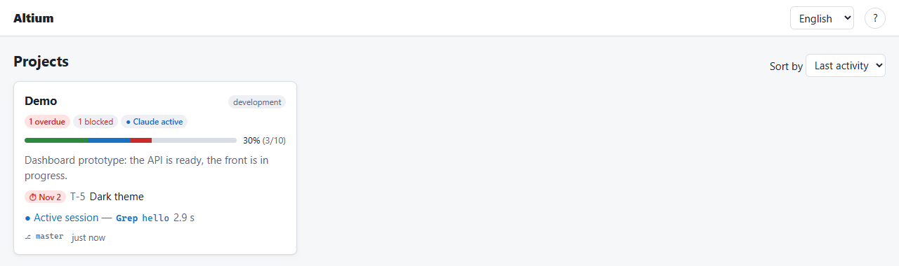
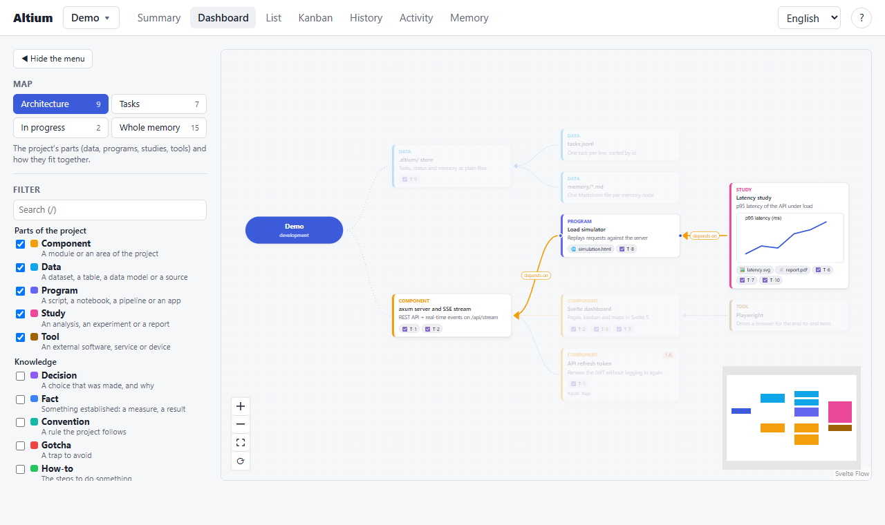
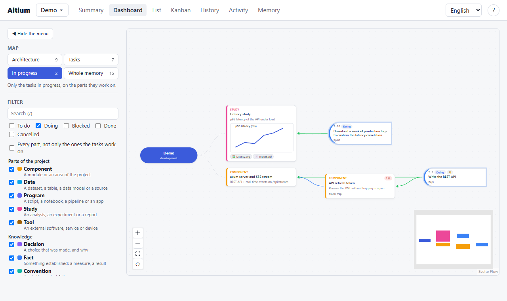
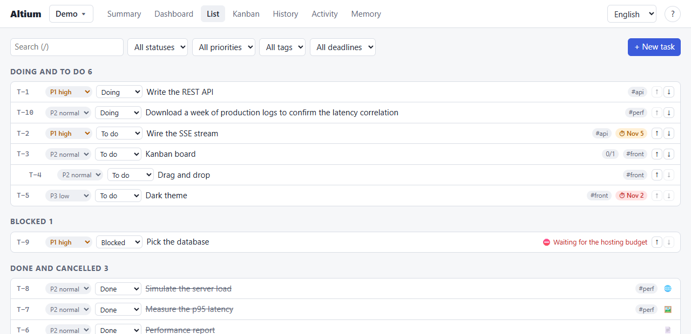
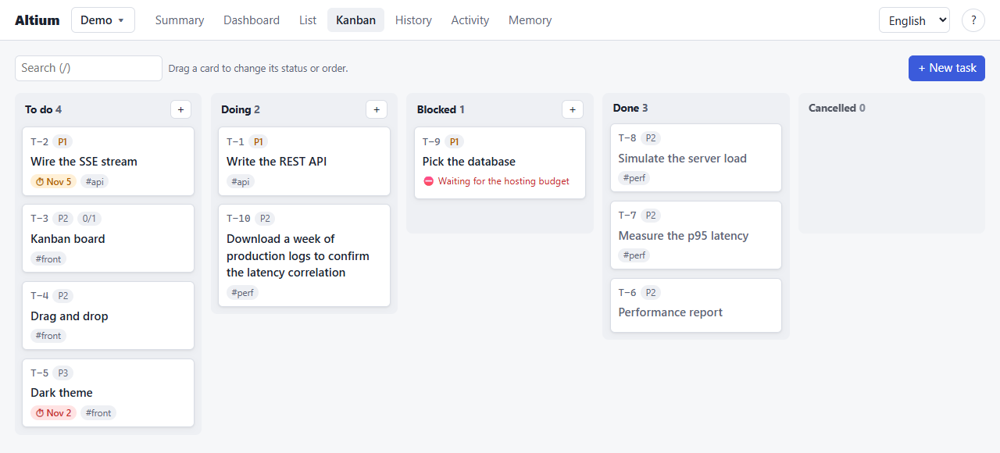
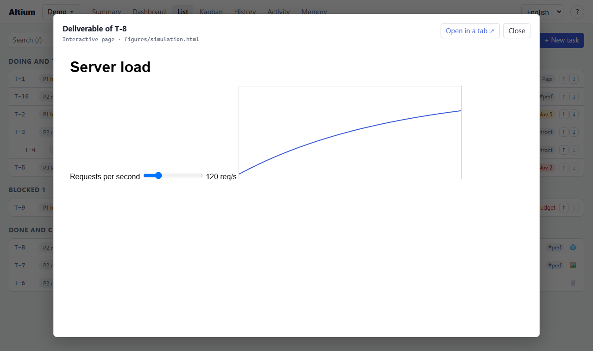
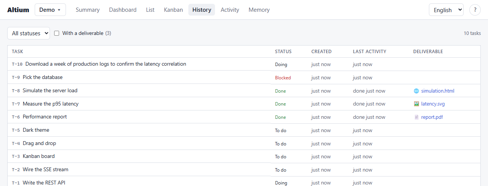
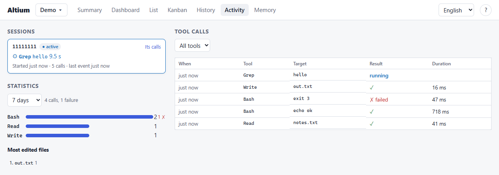

# Altium

**A local dashboard for the projects you build with [Claude Code](https://claude.com/claude-code).**

Claude keeps each project's state in a small `.altium/` folder: a status summary, tasks, a linked memory graph and the activity of its sessions. Altium feeds that context back to every new Claude session, and a live web dashboard on your machine lets you follow and steer all your projects at once.



- **Claude does the bookkeeping.** Hooks and an MCP server let Claude create and update tasks, write the project summary and store durable knowledge as linked memory notes, each change attributed to its session.
- **Every session starts informed.** A compact summary of the project (phase, next tasks, deadlines, memory index) is injected at session start, within a token budget.
- **One dashboard for everything.** Maps of the project's architecture with the tasks on the parts they work on, task list, kanban, history and live Claude activity, updated in real time whether a change comes from Claude, another tab or a hand edit of the files.
- **Local only.** Plain text files you can commit, a server bound to `127.0.0.1`, no account, no cloud.
- **Keeps itself up to date.** `altium update` rebuilds the latest version, and the first command of the day checks for one in the background.

> **Status: V1.** Tested on Windows 11; validation on Linux ([Omarchy](https://omarchy.org)) is in progress, see [`docs/validation.md`](docs/validation.md). The command line is in French, the dashboard in English or French (it follows the browser, with a switch in its header); the files Altium writes and the instructions Claude receives are in English, and memory notes are written in the language you choose.

## Contents

- [Install](#install)
- [Getting started](#getting-started)
- [The dashboard](#the-dashboard)
- [Commands](#commands)
- [Updating](#updating)
- [Configuration](#configuration)
- [The `.altium/` folder](#the-altium-folder)
- [Windows notes](#windows-notes)
- [Development](#development)

## Install

Altium runs on Linux, its main target, and on Windows 10 and 11, with the same commands. It is built from source.

### Linux

Requirements: [Rust](https://rustup.rs) 1.89 or newer, Node.js 20 or newer with npm, `make` and `git`.

```bash
git clone https://github.com/zomboky/altium.git
cd altium
make build
install -Dm755 target/release/altium ~/.local/bin/altium
altium --version
```

### Windows

Requirements:

- [Rust](https://rustup.rs) 1.89 or newer with the default MSVC toolchain, which needs the [Visual Studio Build Tools](https://visualstudio.microsoft.com/visual-cpp-build-tools/) with the "Desktop development with C++" workload (`rustup-init.exe` offers to install them).
- [Node.js](https://nodejs.org) 20 or newer, with npm.
- [Git for Windows](https://git-scm.com/download/win).

`make.ps1` mirrors the `Makefile` targets and runs with the Windows PowerShell 5.1 that ships with Windows:

```powershell
git clone https://github.com/zomboky/altium.git
cd altium
.\make.ps1 build
New-Item -ItemType Directory -Force "$HOME\.local\bin" | Out-Null
Copy-Item target\release\altium.exe "$HOME\.local\bin\"
altium --version
```

If PowerShell refuses to run scripts, allow local scripts for your account with `Set-ExecutionPolicy -Scope CurrentUser RemoteSigned`, or run `powershell -ExecutionPolicy Bypass -File .\make.ps1 build`. `%USERPROFILE%\.local\bin` is already on your `PATH` if you installed Claude Code with its native installer; otherwise add it from "Edit environment variables for your account".

The build produces a single self-contained binary with the web front embedded.

## Getting started

Three commands, once:

```bash
altium setup                              # plug Altium into Claude Code (hooks + MCP server)
altium service install                    # start the dashboard with your session, and now
cd ~/projects/my-api && altium init       # track a project
```

Restart your Claude Code sessions. In a tracked project, each session now starts with the project summary, and Claude keeps tasks, status and memory up to date through the `mcp__altium__*` tools. The dashboard is at http://127.0.0.1:7420.

For a project that already has a history, `altium survey` opens a Claude Code session that reads the code and your past conversations in that folder, fills in the summary and the memory, then proposes tasks one at a time for you to accept or skip.

`altium doctor` checks that everything is in place: hooks, MCP server, binary, dashboard and current project.

## The dashboard

Every page has a stable URL you can bookmark, and everything updates live. Keyboard shortcuts: `n` new task, `p` switch project, `d` dashboard, `l` / `k` / `h` list / kanban / history, `s` summary, `a` activity, `m` memory, `/` search, `g` overview, `?` help.

### Dashboard: the project maps

The **Dashboard** tab draws the project as a map, with the project in the middle. A menu on the side picks the map:

- **Architecture**: the parts of the project and how they fit together. Parts are memory notes of five kinds: components (a module, an area), data (a dataset, a table, a data model, a source), programs (a script, a notebook, a pipeline), studies (an analysis, an experiment, a report) and tools (an external software, service or device). `part_of` links nest them, `depends_on` links say what uses what.
- **Tasks**: the open tasks, each on the parts it works on, with only those parts and the parts above them. A part with hidden sub-parts can show them, for instance the tables of a data model next to the task that downloads data for one of them.
- **In progress**: the same, with only the tasks in progress.
- **Whole memory**: every note, the parts and the knowledge about them (decisions, facts, conventions, gotchas, how-tos, references).

Claude describes the architecture and attaches each task to the parts it works on (`nodes` in `task_create` and `task_update`); the maps follow its changes and the task statuses live. The menu also filters by kind, status, tag and text, with a legend of each kind, changes the layout, and adds a block by hand. Blocks can be moved, and keep their place. Dragging from the dot on a block's edge to another block links them: a task on a part works on it, a task on another task becomes its subtask. Delete removes the selected link or block.





### Tasks

Tasks are listed by priority with their subtasks. Filter by status, priority, tag, deadline or text; change priority and status inline; reorder tasks of the same priority. If Claude edits a task while you are editing it, the form tells you instead of overwriting either change.



The kanban has one column per status. Dragging a card changes its status or its order, and dropping it on "Bloqué" asks for the reason.



### Deliverables and history

A task can name its **deliverable**: a file of the project (a report, a figure, an export, a video, an HTML page) or a URL. Claude sets it when a task produces something. As soon as the file exists, the task form shows « Afficher le livrable », which opens it in a viewer: PDFs, images, videos, sounds and text inline, and interactive HTML pages running sandboxed, with no access to the dashboard.



The **Historique** tab lists the last 100 tasks, most recent first, with a link to each deliverable.



### Memory

Claude stores durable knowledge as short memory notes linked to each other. The memory page lists them with their full text and links; the dashboard draws them as maps. Maps are laid out automatically (vertical or horizontal hierarchy, or organic), and hovering a block highlights its neighbours. Cards show a thumbnail of the first linked image, such as a chart made with Python, and chips for linked PDFs, videos, HTML pages and tasks, which open in the viewer.

### Activity

Claude sessions, the tool running right now with its timer, a filterable feed of tool calls and statistics per period.



### Notifications

The dashboard sends a desktop notification when a task gets close to its deadline (48 hours before by default), when it is overdue, and when Claude blocks a task. Each one is sent once; if the dashboard was stopped, it sends a single recap per project when it starts. On Linux they go through the desktop notification service (mako on Omarchy); on Windows, through the notification center.

## Commands

| Command | What it does |
|---|---|
| `altium setup` | Adds Altium's hooks to `~/.claude/settings.json` (backed up first) and registers the `altium` MCP server for your user. Safe to run again. `--uninstall` removes exactly what it added. |
| `altium init [--name NAME]` | Tracks the current folder: creates `.altium/` and registers the project. Never overwrites an existing file; run again after moving a project to update its path. |
| `altium survey` | Has Claude survey an existing project and propose tasks one by one. Later runs only read new conversations. |
| `altium serve [--port PORT]` | Runs the dashboard in the foreground. |
| `altium open` | Opens the current project (or the overview) in the browser, starting the dashboard if needed. |
| `altium service install` / `uninstall` | Starts the dashboard with your session (systemd user unit on Linux, `Run` registry key on Windows), or stops doing so. |
| `altium list` | Lists tracked projects and flags the ones whose folder is gone. |
| `altium forget [PATH\|ID]` | Stops tracking a project; its `.altium/` folder is left untouched. |
| `altium doctor [--renumber]` | Checks the setup; `--renumber` fixes duplicate task ids, for example after a git merge. |
| `altium update [--check] [--force]` | Updates Altium, see below. |

The hooks never contact the dashboard: they append one line to `.altium/runtime/events.jsonl` and return within milliseconds ([`docs/perf.md`](docs/perf.md)). Claude never deletes a task through MCP; it cancels it. The MCP tools are described in [`docs/mcp.md`](docs/mcp.md).

## Updating

```bash
altium update            # build and install the latest version
altium update --check    # only say whether there is one
```

`altium update` fetches the `main` branch of the Altium repository into its own clone (`altium/source` in your local data folder: `~/.local/share` on Linux, `%LOCALAPPDATA%` on Windows), builds the front and the release binary there, and replaces the binary you ran. A running dashboard is restarted on the new version. It needs the same tools as the install (git, cargo and npm); a build takes a minute or two.

**Daily update.** The first `altium` command of the day, including the hooks Claude Code runs, starts the same update in the background, at low priority, and logs it to `update.log` next to the Altium log. It never runs for a binary inside a cargo `target/` folder. Turn it off with `auto_update = false` in `config.toml` or the `ALTIUM_NO_AUTO_UPDATE` environment variable.

A binary built from a commit the repository does not have (a local development build) is left alone; `altium update --force` installs the latest version anyway. `altium --version` shows the commit a binary was built from.

## Configuration

Global settings live in `config.toml` next to the project registry: `~/.config/altium/` on Linux, `%APPDATA%\altium\` on Windows, or the folder in `ALTIUM_CONFIG_DIR`. Every key is optional.

```toml
port = 7420                  # dashboard port
notifications = true         # desktop notifications
near_deadline_hours = 48     # a task is "near its deadline" from this many hours before it
idle_minutes = 30            # a session counts as inactive after this
memory_lang = "fr"           # language Claude writes memory notes in (default: English)
auto_update = true           # daily background update
update_repo = "https://github.com/zomboky/altium.git"   # where `altium update` builds from
```

Per-project settings go in the `[config]` section of `.altium/project.toml` and take precedence:

```toml
[config]
context_budget = 2000        # tokens of context injected at session start
near_deadline_hours = 24
notifications = false
phases = ["idea", "prototype", "production"]

[config.memory]
lang = "en"                  # this project's memory language, overriding memory_lang
```

## The `.altium/` folder

| File | Content |
|---|---|
| `project.toml` | Project identity and settings |
| `status.json` | Summary and phase |
| `tasks.jsonl` | Tasks, one JSON object per line |
| `memory/` | Memory notes, one Markdown file with YAML front matter each |
| `runtime/` | Local data (events, sessions, caches), not versioned |

Everything is readable text meant to be committed with the project, except `runtime/`, which `.altium/.gitignore` excludes. The format is specified in [`docs/format.md`](docs/format.md) (in French), with a JSON Schema for tasks in [`crates/altium-core/schema/`](crates/altium-core/schema/).

To uninstall: `altium service uninstall`, `altium setup --uninstall`, then delete the binary. Your projects' `.altium/` folders and the registry stay in place.

## Windows notes

- Paths are shown with `\` and your home folder as `~`; `altium forget` accepts them as shown, and ignores case like Windows does.
- `altium service install` writes to your account's `Run` key, without admin rights, and names the notification sender "Altium". A console window flashes for a split second at logon, then the dashboard runs without one.
- On Windows the daily update moves the running binary aside to `altium.old.exe` (a running `.exe` cannot be overwritten) and removes it at the next update.
- Altium writes LF line endings; with `core.autocrlf=true` Git checks them out as CRLF and Altium reads both.
- Accents piped from `altium` in PowerShell (`altium list > projects.txt`) need a UTF-8 console: `[Console]::OutputEncoding = [Text.UTF8Encoding]::new()`.

## Development

| Linux | Windows | Effect |
|---|---|---|
| `make build` | `.\make.ps1 build` | Builds the front, then the release binary |
| `make test` | `.\make.ps1 test` | Rust tests, front type checks and Vitest tests |
| `make e2e` | `.\make.ps1 e2e` | Playwright end-to-end tests against the real binary |
| `make dev` | `.\make.ps1 dev` | Front with hot reload, API proxied to `altium serve` on port 7420 |
| `make clean` | `.\make.ps1 clean` | Removes `target/` and `web/dist/` |

End-to-end tests use the installed Edge on Windows; on Linux, install Playwright's Chromium once with `npx --prefix web playwright install chromium`. Tests never touch your registry or your Claude Code config: they use throwaway ones through `ALTIUM_CONFIG_DIR` and `CLAUDE_CONFIG_DIR`.

`node web/e2e/seed.ts` creates a demo project in a throwaway environment, and `node web/e2e/screenshots.ts` regenerates the screenshots of this README from it (after `cargo build`).

| Folder | Role |
|---|---|
| `crates/altium-core` | Models, `.altium/` storage, registry, session context |
| `crates/altium-cli` | The `altium` binary |
| `crates/altium-server` | Local web server with the embedded front |
| `crates/altium-mcp` | MCP server for Claude Code |
| `web/` | Svelte 5 + Vite + TypeScript front, Svelte Flow for the dashboard maps |
| `prototypes/memory-graph` | Standalone Svelte Flow prototype of the memory graph |
| `openspec/` | Specs and work plan ([OpenSpec](https://github.com/Fission-AI/OpenSpec)) |
